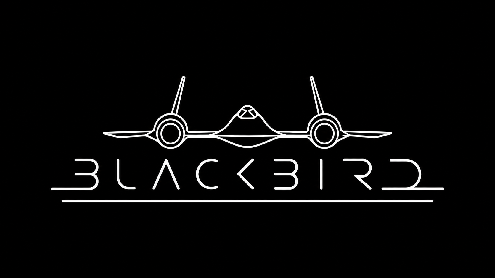

<p align="center">
  
</p>

# BlackBird Launcher — Releases & Distribution
### *Canal oficial de distribución de versiones compiladas (APK) y actualizaciones OTA para autorradios Android*

<p align="center">
  <a href="../../releases/latest">
    
  </a>
</p>

<p align="center">
  
  
  
  
  
  <a href="LICENSE">
    
  </a>
  <a href="PRIVACY.md">
    
  </a>
  <a href="https://github.com/RubyCrack/BL-launcher">
    
  </a>
</p>

---

## 📥 Descarga e Instalación

### Método 1: Actualización Automática OTA (Recomendado)
Si ya tienes instalada una versión de **BlackBird Launcher**:
1. Conecta la autorradio a una red Wi-Fi o punto de acceso móvil.
2. Abre **Ajustes ➔ Sistema ➔ Actualización** en BlackBird Launcher.
3. Elige tu canal preferido:
   * **Estable:** Recibe exclusivamente versiones definitivas y consolidadas para el día a día.
   * **Beta:** Recibe versiones preliminares (*pre-releases*) con las últimas características antes de su despliegue general.
4. Pulsa **COMPROBAR**: la aplicación detectará automáticamente si hay una nueva versión publicada en este repositorio, verificará su integridad criptográfica (SHA-256), soportará descargas reanudables ante cortes de red (cabecera HTTP Range) y te guiará para instalarla directamente en pantalla.

El canal **Estable** está seleccionado por defecto y consulta la última release pública. Si seleccionas **Beta**, buscará tanto pre-releases como versiones estables, ofreciendo la que posea el `versionCode` más alto. Puedes alternar de canal en cualquier momento desde Ajustes.

> [!IMPORTANT]
> **Seguridad en Marcha:** Por normativa de seguridad vial y diseño HMI automotriz, las operaciones de actualización y confirmación de instalación requieren que el vehículo se encuentre completamente detenido.

Para que una release de cualquiera de los dos canales se ofrezca vía OTA, debe incluir `versionCode: N` en su descripción y un APK con digest SHA-256 publicado en los metadatos de GitHub Releases. El actualizador comprueba además el tamaño, el paquete, la firma criptográfica y que la versión sea posterior a la instalada. Las releases en borrador no se ofrecen.

---

### Método 2: Instalación Manual por APK
1. Descarga el paquete `app-release.apk` de la versión más reciente desde la sección [Releases](../../releases/latest).
2. Copia el archivo a una memoria USB (formateada en FAT32 o NTFS) o descárgalo directamente desde el navegador web de la autorradio.
3. Conecta el USB a la pantalla, abre el explorador de archivos nativo, pulsa sobre el APK e instala la aplicación (habilita la opción de *Instalar aplicaciones de fuentes desconocidas* si el sistema lo solicita).
4. Pulsa el botón físico o táctil **HOME** de la consola o del volante y selecciona **BlackBird** como aplicación de inicio predeterminada (*«Siempre»*).

---

## 🚗 Matriz de Compatibilidad de Hardware

| Componente / Subsistema | Nivel de Compatibilidad | Especificaciones Técnicas |
| :--- | :---: | :--- |
| **Android Base** | **Nativo** | Compatible desde Android 9.0 (API 28) hasta Android 12.0. |
| **SoC Objetivo** | **Nativo** | Optimizado específicamente para procesadores MediaTek AC8257, Autochips y Jancar. |
| **Arquitecturas CPU** | **Nativo** | Compatible con ARM64 (`arm64-v8a`) y ARMv7 (`armeabi-v7a`). |
| **Resoluciones HMI** | **Nativo** | Formatos panorámicos de automoción (1024×600 y 1280×720) a 160 dpi. |
| **Radio FM/AM Física** | **Soportado** | Control directo del chip sintonizador de la placa base vía interfaz Binder IPC. |
| **Bluetooth OEM** | **Soportado** | Manos libres y streaming mediante el servicio de audio del fabricante. |
| **Bus CAN Nativo** | **Soportado** | Lectura pasiva de telemetría (odómetro, combustible), marcha atrás e iluminación. |
| **Posicionamiento GNSS** | **Nativo** | Fusión satelital continua con amortiguación de fluctuaciones e interpolación temporal (delta-time). |

> [!NOTE]
> **Aviso de Rendimiento y Plataforma de Validación:**
> BlackBird Launcher está calibrado, perfilado y validado exhaustivamente en bancos de pruebas reales con hardware **MediaTek AC8257 / Jancar en Android 9.0 (API 28)**. Para garantizar la estabilidad térmica y evitar *throttling* en pantallas empotradas en salpicaderos, el motor de renderizado opera bajo un presupuesto térmico dinámico de **30 FPS con interpolación continua de cuadros (delta-time)**, lo que permite un desplazamiento analógico suave de las agujas sin recalentar la CPU ni la VRAM. En autorradios con procesadores alternativos (Allwinner, Rockchip, Unisoc) o ROMs genéricas de otros fabricantes, la compatibilidad con el chip de radio o la decodificación del bus CAN puede variar según la capa de servicios del fabricante.

---

## 🔒 Integridad Criptográfica (SHA-256)

El actualizador OTA comprueba automáticamente el hash criptográfico de cada archivo antes de ofrecer su instalación. Si descargas manualmente, puedes verificar el **SHA-256** del APK frente al publicado en las notas de la release:

* **En macOS / Linux:**
  ```bash
  shasum -a 256 app-release.apk
  ```
* **En Windows (PowerShell):**
  ```powershell
  Get-FileHash app-release.apk -Algorithm SHA256
  ```

Cada release identifica además el commit o tag exacto del [código fuente correspondiente](https://github.com/RubyCrack/BL-launcher) y el procedimiento para reproducir la compilación.

---

## 📋 Registro de Versiones Reciente

### [v3.8.0 (Canal Beta / Pre-release)](../../releases/tag/v3.8.0)
* **Ordenador de Viaje Resiliente a Sleep:** Blindaje de `TripComputer` frente a suspensiones profundas de la MCU del coche, evitando acumulación espuria de tiempo o distancias irreales al despertar.
* **Presupuesto Térmico Dinámico en Agujas:** Reducción adaptativa de tasa de refresco a nivel de vista ante calentamiento prolongado del salpicadero, manteniendo fluidez visual sin saturar la GPU.
* **Fusión GPS de Precisión:** Salto y validación cinemática calculados a partir del intervalo temporal real entre muestras satelitales en vez del pulso del planificador.
* **Descargas OTA Reanudables:** Soporte de cabecera HTTP `Range` (206 Partial Content) para reanudar descargas de paquetes interrumpidas por pérdida momentánea de cobertura 4G/Wi-Fi sin reiniciar desde cero.

### [v3.7.7 (Release Oficial)](../../releases/tag/v3.7.7)
* **Estabilización del Motor OTA:** Sincronización atómica de hilos en segundo plano durante la verificación y descompresión de paquetes.
* **Optimización de Memoria en Redes Wi-Fi:** Eliminación de bloqueos de interfaz mediante caché de paleta en memoria en `WifiAdapter`.
* **Sincronización de Bus CAN:** Resincronización robusta de estados de cabina, puertas e iluminación tras pausas de la pantalla.

### [v3.7.6 (Release Oficial — "Jazz")](../../releases/tag/v3.7.6)
* **Mitigación Térmica Proactiva:** Balanceo de carga en segundo plano para unidades empotradas de disipación pasiva.
* **Visualizador de Audio en Tiempo Real:** Optimización del buffer FFT en el módulo de radio FM para captura sonora de baja latencia.
* **Compatibilidad Bluetooth OEM:** Mejora en el desacoplo de reconexión de perfiles manos libres y streaming multimedia A2DP.

### [v3.7.5 (Release Oficial)](../../releases/tag/v3.7.5)
* **Motor de Radares Headless:** Detección de cinemómetros continua en segundo plano unificada para todos los cuadros (Classic, Card y Performance), sin depender de Google Maps ni consumir memoria de vídeo.
* **Aguja Analógica Fluida (30 FPS con Delta-Time):** Interpolación cinemática crítica que elimina tirones entre tramas de señal GPS y CAN.
* **Actualizador OTA Integrado:** Selector táctil de canales (**Estable** vs **Beta**), verificación SHA-256 obligatoria y comprobación de firma criptográfica.
* **Tipografía Inter y Estética CarPlay:** Estandarización de la tipografía **Inter** (Regular, Medium, Bold), esquinas redondeadas uniformes a 16dp y elevación de contraste diurno (`#CCFFFFFF`).
* **Nuevos Temas y Mapas Vectoriales:** Incorporación de **Sport Red** y **Cyber Purple** con perfiles JSON dedicados para Google Maps y blindaje de seguridad HMI en velocímetro.

### [v3.7.4 (Release Oficial)](../../releases/tag/v3.7.4)
* **Coordinador de Reanudación (`HomeResumeCoordinator`):** Sincronización atómica de perfiles al volver a primer plano y supresión síncrona en marcha atrás.
* **Telemetría de Velocidad:** Reconciliación de frescura al reanudar y distinción matemática entre 0 km/h y señal no disponible (`--`).
* **Privacidad Estricta en CAN y Bluetooth:** Anonimización de números de teléfono, contactos y exclusión de coordenadas GPS privadas en registros de diagnóstico.
* **Escuchador de Notificaciones:** Sistema de arrendamiento atómico (`NotificationListenerLease`) y filtrado ultrarrápido (<1 µs) de guiado (Maps/Waze).
* **Clima Resiliente:** Detección de saltos temporales del reloj (`ClockSanity`) y fusión inmutable CAN-Bus + API meteorológica.
* **Segundo Plano:** Suspensión de animaciones y liberación de recursos gráficos al pausar la interfaz.

---

## ⚖️ Marco Legal, Privacidad y Seguridad Vial

Esta distribución incluye la licencia, la información de privacidad y los avisos siguientes:

| Documento | Descripción |
| :--- | :--- |
| **[TERMS.md](TERMS.md)** | **Aviso de Uso y Seguridad Vial:** Reglas de atención al volante, límites de velocidad y radares, y condiciones de la licencia GPLv3 en la medida permitida por la ley. |
| **[PRIVACY.md](PRIVACY.md)** | **Información de Privacidad:** Almacenamiento local, permisos, diagnósticos y consultas a Open-Meteo, Overpass, Google Maps y GitHub. No se afirma certificación RGPD. |
| **[LICENSE](LICENSE)** | **Licencia de Software:** Distribuido bajo la licencia [GNU General Public License v3.0 (GPLv3)](LICENSE). |
| **[ATTRIBUTIONS.md](ATTRIBUTIONS.md)** | **Atribuciones de Terceros:** Licencia de Bases de Datos Abiertas (ODbL 1.0) de © OpenStreetMap (radares Overpass), datos de Open-Meteo, tipografía Inter (SIL OFL 1.1) y librerías de código abierto. |
| **[SECURITY.md](SECURITY.md)** | **Política de Seguridad:** Procedimiento para el reporte responsable de incidencias de seguridad a través de GitHub Security Advisories. |

---

<p align="center">
  <sub>BlackBird Launcher — Desarrollado por <a href="https://github.com/RubyCrack">RubyCrack</a> bajo licencia <a href="LICENSE">GPLv3</a>.<br>Código fuente completo disponible en <a href="https://github.com/RubyCrack/BL-launcher">RubyCrack/BL-launcher</a>.</sub>
</p>
